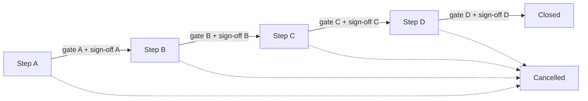

# A3 Tracker — Structured Problem Solving Framework

A lightweight web application to **create, track and maintain A3 problem-solving projects** for a small team.
It guides users through the A3 steps in sequence, checks every step against configurable quality gates,
records Champion sign-offs and a full change history, and gives a portfolio overview across all A3s.

> **Disclaimer:** This tool is a coaching and tracking aid. The default quality-gate rules come from general
> A3 / structured problem solving guidance. They are **not** a copy of any company rule, trigger matrix
> or evaluation sheet. Align `a3config.toml` with your approved rule before using the tool for formal approval.
> The tool never assigns a severity and never replaces mandatory customer formats (e.g. 8D in CQTS).

---

## Contents

1. [Features](#features)
2. [Requirements](#requirements)
3. [Installation](#installation)
4. [Starting and stopping the server](#starting-and-stopping-the-server)
5. [First start: create the admin account](#first-start-create-the-admin-account)
6. [Users and roles](#users-and-roles)
7. [Password reset and account recovery (including admin)](#password-reset-and-account-recovery-including-admin)
8. [Working with an A3 — step by step](#working-with-an-a3--step-by-step)
9. [Quality gates](#quality-gates)
10. [Champion sign-off and status workflow](#champion-sign-off-and-status-workflow)
11. [Portfolio, registers, statistics and search](#portfolio-registers-statistics-and-search)
12. [Templates, duplicating and drafting from notes](#templates-duplicating-and-drafting-from-notes)
13. [Export, print and copy to myA3Creator](#export-print-and-copy-to-mya3creator)
14. [Change history](#change-history)
15. [Configuration (`a3config.toml`)](#configuration-a3configtoml)
16. [Demo data](#demo-data)
17. [Data, backup and restore](#data-backup-and-restore)
18. [Security notes](#security-notes)
19. [Troubleshooting](#troubleshooting)
20. [Project structure and development](#project-structure-and-development)

---

## Features

| Area | What you get |
|---|---|
| **A3 structure** | General information + Step A (Describe the problem), B (Root cause), C (Solution), D (Validate, standardize, share) |
| **Quality gates** | Automatic checks per step (required / advice), each with a stable ID that can be configured |
| **Sequence enforcement** | An A3 can only move forward when earlier gates pass and the Champion has signed off |
| **Champion sign-off** | Approve / Rework required per step; approvals become invalid when the step content changes |
| **Change history** | Every field change, added / deleted entry, status change and sign-off with user, time, old and new value |
| **Root cause tools** | Hypothesis log (Untested → Verified / Excluded / Inconclusive), Is / Is Not, Fishbone view, structured Why-Why chains |
| **Action tracking** | Containment, correction, technical corrective, systemic / preventive, validation and standardization actions; overdue highlighting |
| **Effectiveness** | KPI measurements with a trend chart against the Step A baseline and target |
| **Basic / Standard / Extended** | Different fields, sections and gate rules per A3 type (configurable) |
| **Roles** | viewer, member, team_leader, champion, admin |
| **Portfolio** | Dashboard, statistics, action tracker, Read Across and Lessons Learned registers, full-text search |
| **Convenience** | Templates, duplicate A3, draft from notes / documents, copy buttons, picklists, Markdown / Excel / PDF export |

---

## Requirements

- Windows, macOS or Linux
- Python **3.11 or newer** (uses the built-in `tomllib`)
- A modern browser (Edge, Chrome, Firefox)
- Python packages (installed automatically): Flask, openpyxl, waitress, pypdf, pytest

---

## Installation

```powershell
# 1. Get the code
git clone <your-repository-url> a3-tracker
cd a3-tracker

# 2. Create a virtual environment
python -m venv .venv
#    If this fails with "venvlauncher.exe" missing (broken Python install), use:
#    python -m pip install virtualenv
#    python -m virtualenv .venv

# 3. Install dependencies
.\.venv\Scripts\python -m pip install -r requirements.txt      # Windows
# ./.venv/bin/python -m pip install -r requirements.txt        # macOS / Linux
```

All commands below use the Windows path `.\.venv\Scripts\python`. On macOS / Linux use `./.venv/bin/python`.
Alternatively activate the environment once (`.\.venv\Scripts\Activate.ps1`) and just type `python`.

---

## Starting and stopping the server

The tool is a small web server. It runs as long as the terminal window that started it stays open.

### Start (only you, on your PC)

```powershell
.\.venv\Scripts\python run.py
```

Open **http://127.0.0.1:8080** in the browser.

### Start for the team

One machine runs the server; everybody else uses the browser.

```powershell
.\.venv\Scripts\python run.py --host 0.0.0.0 --port 8080 --data-dir "D:\A3data"
```

Colleagues open `http://<computer-name-or-IP>:8080`. Windows Firewall may ask you to allow Python the first time.

| Option | Meaning | Default |
|---|---|---|
| `--host` | `127.0.0.1` = only this PC, `0.0.0.0` = reachable from the network | `127.0.0.1` |
| `--port` | Port number | `8080` |
| `--data-dir` | Folder with the database (`a3.sqlite3`), secret key and optional `a3config.toml` | `./instance` |

> Do **not** let several people start their own server on the same database file on a network share.
> SQLite on network drives can corrupt with concurrent writers. Run **one** server and share the URL.

### Stop

Press **Ctrl+C** in the terminal (or close it). If a server keeps running in the background:

```powershell
Get-NetTCPConnection -LocalPort 8080 -State Listen | ForEach-Object { Stop-Process -Id $_.OwningProcess }
```

Stopping the server never deletes data.

---

## First start: create the admin account

On the very first start there are no users. Open the app **on the server machine itself**
(`http://127.0.0.1:8080`) and you are redirected to **"Create the first admin account"**.
This page only works from the server machine and only while no user exists.

Alternatively, create the admin from the command line:

```powershell
.\.venv\Scripts\python manage.py create-user admin --name "Your Name" --role admin
```

You are prompted for the password (minimum 10 characters).

---

## Users and roles

Admins manage users under **Users** in the top menu (add user, change role, deactivate, reset password).
Every user can change their own password under **their name → Account** (top right).

| Role | Can do |
|---|---|
| **viewer** | Read everything, search, statistics, export / print |
| **member** | + create A3s, edit content and lists, duplicate, draft from notes |
| **team_leader** | + change the A3 status, mark A3s as templates |
| **champion** | + Champion sign-off of steps (which roles may sign off is configurable) |
| **admin** | + manage users, delete A3s |

Roles are cumulative (each role includes the rights of the roles above it in the table).
The **display name** is what appears in the change history and in sign-offs.

---

## Password reset and account recovery (including admin)

### A normal user forgot the password

An admin opens **Users**, types a new password in **Reset password** for that user and clicks **Save**.
The user then logs in and changes it under **Account**.

### The admin forgot the password and cannot log in

Recovery is done on the **server machine** with `manage.py`. You need access to the folder where the tool is installed
(and to the data folder if you use `--data-dir`). The server may keep running.

1. Open a terminal in the tool folder:
   ```powershell
   cd "D:\path\to\a3-tracker"
   ```
2. If you are not sure about the username, list all users:
   ```powershell
   .\.venv\Scripts\python manage.py list-users
   ```
   Output example:
   ```text
   admin                admin        active    Jane Doe
   mweber               champion     active    M. Weber
   ```
3. Set a new password (you are prompted twice; minimum 10 characters). This also re-activates the account:
   ```powershell
   .\.venv\Scripts\python manage.py set-password admin
   ```
4. Log in again in the browser.

If the server is started with a data folder, add the same option to every `manage.py` command:

```powershell
.\.venv\Scripts\python manage.py --data-dir "D:\A3data" set-password admin
```

### Other recovery situations

| Situation | Fix |
|---|---|
| The admin account was **deactivated** | `manage.py set-password <username>` (re-activates) or `manage.py set-role <username> admin` |
| The last admin was **demoted** to another role | `.\.venv\Scripts\python manage.py set-role <username> admin` |
| Nobody knows any admin account | Create a new one: `.\.venv\Scripts\python manage.py create-user rescue-admin --name "Rescue Admin" --role admin` |
| **"Too many failed attempts"** after 5 wrong passwords | Wait 15 minutes, or restart the server (the lock is kept in memory only) |
| You have no access to the server machine | Ask the person who runs the server; recovery is intentionally not possible through the browser |

> The `/setup` page cannot be used for recovery: it is disabled as soon as one user exists.

---

## Working with an A3 — step by step

### 1. Create the A3

On **Portfolio**, type a title and click **Create A3**. Optionally choose a template.
The title must describe the **problem or gap**, not a suspected cause or a preferred solution
(a gate check warns about cause / solution words such as *because*, *due to*, *implement*, *retrain*).

### 2. General tab

Champion, Team Leader, team members, A3 type (Basic / Standard / Extended), trigger, severity
(select the value classified per your rule — the tool never assigns it), customer-specific format check, scope in / out.

- **Customer complaint** as trigger → you must record whether A3 is sufficient or an 8D / other customer format is required.
- **High severity** (configurable, default 1 and 2) → an alert reminds you of Early Warning, cross-organizational
  notification, myA3Creator documentation and Fast Track Learning / Read Across.

### 3. Step A — Describe the problem

Fill background, symptom, quantified problem description, expected requirement, data sources, Early Warning,
containment (actions + exit criteria + evidence that containment works) and the **target**: metric, baseline,
target value, direction (lower / higher is better), population and date.

Lists on this tab: **Is / Is Not** entries and **Containment** actions.

### 4. Step B — Identify the root cause

- Record every cause as a **hypothesis** with category (Occurrence, Detection / escape, Systemic), fishbone category,
  verification method, expected vs. actual result, evidence and status.
  Only set **Verified** when the evidence supports it.
- The **Fishbone** view groups all hypotheses by category (verified ones in green, excluded ones struck through).
- Build **Why-Why chains**: each step is linked to a starting (verified) cause, has its own evidence and status, and
  you mark where the technical or systemic root cause is reached.
- If no detection / escape cause or no systemic cause applies, write the justification in the corresponding field.

### 5. Step C — Determine and implement the solution

Add corrective actions (Correction, Technical corrective, Systemic / preventive). Each action must be **linked to a
verified cause**, and each verified cause must have an action. Record owner, due date, expected result / verification
plan, alternatives considered, decision rationale and risks. Overdue actions are highlighted in red.

### 6. Step D — Validate, standardize and share

- Add **KPI measurements** (date + value). The chart shows them against the Step A baseline and target and tells you
  whether the latest value meets the target.
- Set each corrective action's **Result** to *Effective* only with evidence — *Done* is not *Effective*.
- Record observed result, observation window, evidence, non-recurrence check, containment removal,
  standardization (with Process Owner / Rule Manager), **Read Across** items and **Lessons Learned**
  (or the reason why no new item is needed).

### 7. Close

When all gates pass and all steps are signed off, a team leader (or higher) sets the status to **Closed**.

---

## Quality gates

Each tab shows its gate panel on the right:

- ✔ green — check passed
- ✖ red — **required** check open (blocks status change and Champion approval)
- ! orange — **advice** (weakness to consider, does not block)

Hover a check to see its **ID** and level, e.g. `a.problem_quantified (advice)`.

**Placeholders count as empty:** text containing `[[...]]` (template placeholders) or `[UNVERIFIED IMPORT]`
(drafted from notes) does not satisfy any check until somebody reviews and edits it.

### All check IDs

| Step | IDs |
|---|---|
| General | `g.title`, `g.title_neutral`, `g.champion`, `g.team_leader`, `g.team_members`, `g.trigger`, `g.severity`, `g.scope`, `g.customer_format`, `g.basic_high_severity` |
| A | `a.background`, `a.symptom`, `a.problem`, `a.problem_quantified`, `a.problem_no_solution`, `a.problem_no_cause`, `a.expected`, `a.data_sources`, `a.is_is_not`, `a.containment`, `a.containment_owner`, `a.containment_exit`, `a.containment_effective`, `a.early_warning`, `a.early_warning_notes`, `a.target_metric`, `a.target_baseline`, `a.target_value`, `a.target_date` |
| B | `b.hypotheses`, `b.multiple_hypotheses`, `b.tested`, `b.verified_evidence`, `b.occurrence`, `b.detection`, `b.systemic`, `b.methods`, `b.none_pending`, `b.why_chain`, `b.why_supported`, `b.why_root` |
| C | `c.actions`, `c.linked`, `c.covered`, `c.owners`, `c.verification_plan`, `c.weak_actions`, `c.alternatives`, `c.risks` |
| D | `d.actions_done`, `d.effective`, `d.observed`, `d.evidence`, `d.kpi_recorded`, `d.kpi_meets_target`, `d.target`, `d.recurrence`, `d.containment_removed`, `d.standardization`, `d.read_across`, `d.read_across_closed`, `d.lessons`, `d.champion_feedback` |

The **Readiness** label (Ready / Partially ready / Not ready) summarises the gates. It is not an approval.

---

## Champion sign-off and status workflow



- The **sign-off panel** is on the right of tabs A–D. Users with a sign-off role choose **Approved** or
  **Rework required** (a comment is mandatory for rework).
- **Approved** is only possible when the step has no open required checks.
- If anything in that step changes after approval, the approval is marked *changed since sign-off* and no longer counts.
- Approved steps show a ★ on their tab.
- **Moving forward** (team_leader or higher) requires every earlier gate to pass and every earlier step to be signed off.
  Moving backwards or to *Cancelled* is always possible.
- Sign-off requirement and allowed roles are set in `a3config.toml` → `[workflow]`.

---

## Portfolio, registers, statistics and search

| Page | Content |
|---|---|
| **Portfolio** | All A3s with status, severity, gate status per step (green / red dots), open and overdue actions, readiness. Filter by status. |
| **Statistics** | Totals, closure rate, closed in the last 90 days, average age of open A3s, average lead time, average days per step, readiness, breakdowns by status / severity / trigger / department / type, overdue actions by owner and department, oldest open A3s. |
| **Action tracker** | All open actions of all active A3s, sorted by due date, overdue in red. |
| **Read Across** | All Read Across items across A3s. |
| **Lessons Learned** | All Lessons Learned items across A3s. |
| **Search** (top bar) | Searches every text field and list entry of all A3s (titles, causes, part numbers, defect codes, people, …). Results link directly to the right tab. |

Templates are excluded from portfolio lists, statistics and registers.

---

## Templates, duplicating and drafting from notes

### Templates

1. Create an A3 and fill guidance text, using `[[...]]` for anything the user must replace.
2. On the **General** tab click **Use as template for new A3s** (team_leader or higher).
3. On the Portfolio, choose the template in the **Create A3** drop-down.

### Duplicate an A3

On the **General** tab open **Duplicate this A3**, enter a new title and select which steps' text fields to copy.
Lists (hypotheses, actions, …) are not copied. Review every copied field — facts of the original may not apply.

### Draft from notes / document

Open an A3 → **Draft from notes / document**.

1. Paste notes, an incident description or an e-mail, and/or upload a `.docx`, `.pptx`, `.pdf`, `.txt`, `.md`,
   `.eml` or `.csv` file (max. 10 MB).
2. The tool splits the text into sentences and **proposes** a destination for each (background, symptom, problem
   description, expected requirement, data sources, new containment action, new cause hypothesis).
   This is keyword-based pre-sorting, not an analysis.
3. Change destinations or choose *Skip*, then click **Add to A3 as unverified draft**.

Every imported sentence is marked `[UNVERIFIED IMPORT]` and counts as empty for the gates until edited.
Do not upload information beyond what the A3 team is allowed to see.

### Picklists

Location, department and topic code offer suggestions from `a3config.toml` (`[picklists]`); free text is still allowed.

---

## Export, print and copy to myA3Creator

| Function | Where | Result |
|---|---|---|
| **Copy** button | Next to every text field | Copies the field content to the clipboard for pasting into myA3Creator |
| **Export Markdown** | A3 header | `A3_<id>.md` with all fields, open gate checks and lists |
| **Export Excel** | A3 header | `A3_<id>.xlsx`, one sheet for the A3 and one per list |
| **Print / PDF** | A3 header | Print view incl. gates, sign-offs and KPI chart → use the browser's *Save as PDF* |

---

## Change history

**Change history** (A3 header) lists all sign-offs and every change: time, user, step, item, field, old and new value.
History is kept even when an A3 is deleted (admins only).

---

## Configuration (`a3config.toml`)

The app reads `<data-dir>/a3config.toml` if it exists, otherwise `a3config.toml` in the program folder.
Edit it with any text editor and **restart the server**. An invalid file stops the server with a clear message.
The footer of every page shows whether the configuration has been aligned with a rule revision.

```toml
[meta]
rule_reference = "QM-RULE-001"  # identifier of your problem-solving rule
rule_revision = "C"           # fill in after alignment -> shown in the footer
aligned_by = "SPS coordinator"
aligned_on = "2026-11-01"

[picklists]
triggers = ["Customer request or complaint", "Audit", "..."]
severities = ["Not assessed", "1", "2", "3", "4", "Not applicable"]
fishbone_categories = ["Man", "Machine", "Method", "Material", "Measurement", "Environment", "Management"]
locations = ["Plant North", "Plant South"]
departments = ["Quality", "R&D"]
topic_codes = ["Q-2026-"]

[severity]
high = ["1", "2"]             # triggers Early Warning alerts and extra checks

[workflow]
signoff_steps = ["a", "b", "c", "d"]
require_signoff_to_advance = true
signoff_roles = ["champion", "admin"]

[checks]                      # global level per check: "required" | "advice" | "off"
"a.problem_quantified" = "required"

[a3_types.Basic]              # per A3 type
hidden_fields = ["deliverables", "methods_used"]
hidden_sections = ["is_is_not", "fishbone", "why_step"]
[a3_types.Basic.checks]       # overrides [checks] for this type
"a.is_is_not" = "off"
```

Sections marked `ALIGN` in the shipped file must be reviewed by the rule owner / SPS coordinator.

---

## Demo data

`seed_demo.py` loads **23 fictional A3s and 2 templates** that showcase every feature: all statuses (Step A to Closed,
one Cancelled), all A3 types, severities 1–4, different triggers and departments, verified and excluded hypotheses,
Why-Why chains, overdue actions, KPI trends, Read Across, Lessons Learned, sign-offs (including one *Rework required*)
and a back-dated history so the statistics are meaningful.

```powershell
.\.venv\Scripts\python seed_demo.py            # add demo A3s (refuses if they already exist)
.\.venv\Scripts\python seed_demo.py --remove   # remove all demo A3s again
.\.venv\Scripts\python seed_demo.py --data-dir "D:\A3data"
```

Demo A3s have topic codes starting with `DEMO-`. All names, plants, parts and figures are invented.
The script checks after loading that every demo A3 passes the gates required for its status.

---

## Data, backup and restore

All data lives in the data folder (default `instance/`):

| File | Content |
|---|---|
| `a3.sqlite3` | Database: A3s, lists, users, history, sign-offs |
| `secret_key` | Session signing key (generated on first start; keep it private) |
| `a3config.toml` | Optional site-specific configuration |

**Backup:** stop the server (or make sure nobody is saving) and copy `a3.sqlite3` to a safe place, e.g.

```powershell
Copy-Item instance\a3.sqlite3 "backup\a3_$(Get-Date -Format yyyyMMdd).sqlite3"
```

**Restore:** stop the server, copy the backup back to `a3.sqlite3`, start the server.

**Upgrades:** new versions add missing tables / columns automatically on start. Make a backup first.

The `instance/` folder is listed in `.gitignore` — **never commit it** (it contains user data, password hashes and the secret key).

---

## Security notes

- Passwords are stored as salted hashes (Werkzeug); minimum length 10.
- 5 failed logins lock the username for 15 minutes.
- All forms are protected against CSRF; sessions expire after 12 hours.
- All database queries are parameterised; uploaded documents are size-limited and parsed without executing content.
- The server speaks plain HTTP. In a team network, run it only inside the company network, or put it behind an
  HTTPS reverse proxy. Do not expose it to the internet.
- Respect confidentiality: everybody with an account can read all A3s.

---

## Troubleshooting

| Problem | Solution |
|---|---|
| `python -m venv` fails with `venvlauncher.exe` missing | Use `python -m pip install virtualenv` and `python -m virtualenv .venv` |
| Browser shows "This site can't be reached" | The server is not running, or wrong port / host. Check the terminal output. |
| Colleagues cannot connect | Start with `--host 0.0.0.0`, allow Python in Windows Firewall, use the server's computer name or IP |
| "Invalid or missing CSRF token" | The page was open too long or the server was restarted — reload the page and repeat |
| "This A3 was changed by someone else" | Someone saved the same A3 after you opened it. Reload, re-apply your changes |
| "Cannot move to …" | Open the listed tab, fix the red checks, get the Champion sign-off, try again |
| "Cannot approve" | The step still has red (required) checks |
| Config error on start | The message names the wrong key / value in `a3config.toml` |
| Forgot password / locked out | See [Password reset and account recovery](#password-reset-and-account-recovery-including-admin) |
| `database is locked` | Another process is writing; only run one server per database |

---

## Project structure and development

```text
a3app/
  __init__.py      app factory, login + CSRF guard
  auth.py          login, roles, users, password handling
  config.py        a3config.toml loader / validation
  db.py            SQLite access, history, sign-off, search, migrations
  gates.py         quality-gate checks (IDs, levels)
  model.py         field definitions, picklists
  routes.py        A3 pages, workflow, import, search, statistics
  stats.py         portfolio statistics
  charts.py        server-side SVG KPI chart
  importer.py      draft-from-notes text extraction
  export.py        Markdown / Excel export
  schema.sql       database schema
  templates/       HTML (Jinja2)
  static/          CSS, JS (copy buttons)
a3config.toml      default configuration
run.py             start the server
manage.py          user administration CLI
seed_demo.py       demo data
tests/             pytest tests
```

Run the tests:

```powershell
.\.venv\Scripts\python -m pytest -q
```

Adding a gate check: add a `GateCheck("<step>.<name>", ...)` in `a3app/gates.py`; its level can then be set in
`a3config.toml`. Adding a database column: add it to `schema.sql` **and** to `MIGRATIONS` in `a3app/db.py` so existing
databases are upgraded.
